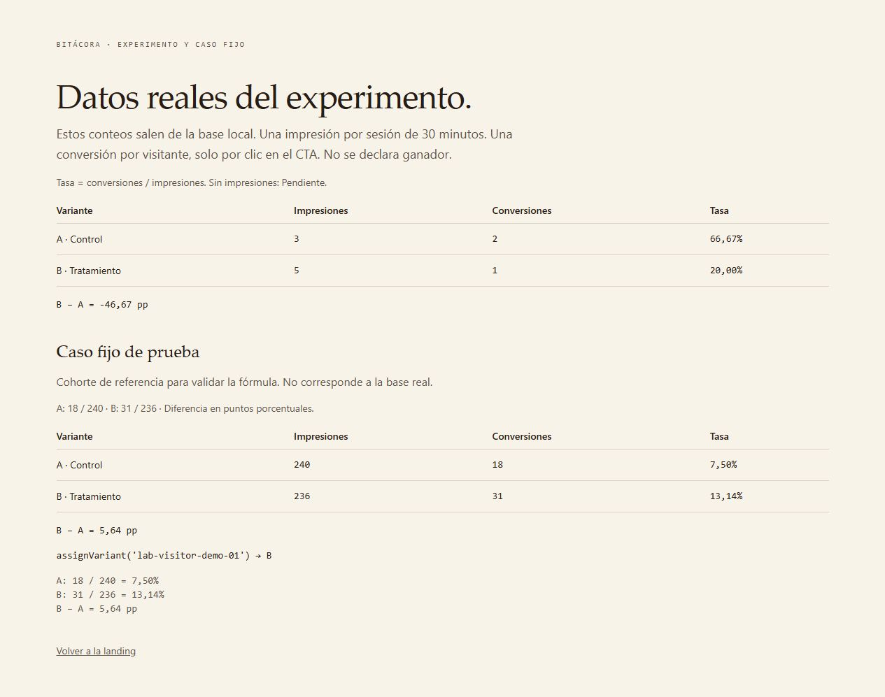

# TP8 — Experimento A/B y SEO · Informe (Taller Norte)

## 1. Persona asignada a B

La persona asignada a la variante B (tratamiento) ve:

- Titular: "El curso empieza el 14 de abril." con énfasis "El cupo, no."
- CTA: "Reservar mi lugar"
- Title (SEO): "Abril abre cupos: cursos de oficio en grupos de 12"
- Description (SEO): "El 14 de abril empiezan grupos de doce. En la cohorte anterior, ocho de cada diez consiguieron trabajo en el rubro antes de los noventa días."

Qué permanece igual: la oferta. Inicio 14 de abril, duración 8 semanas, cupo de 12 personas y oficios carpintería, electricidad y cocina. Solo cambia el mensaje; la propuesta de valor no se modifica.

## 2. Crawler

Un crawler normal no conserva cookies. Eso es un problema para un experimento porque, sin cookies, cada visita parecería una persona nueva y la variante podría cambiar en cada request, generando contenido inestable e indeseable para indexación.

En la implementación, un crawler sin cookies recibe el control A de forma estable. Se detecta por user-agent de crawler (bot, crawl, spider, etc.). No se crean cookies de visitante/variante para él, no se registra impresión y la página queda fija en A.

La misma URL se mantiene (/practica) y el canonical es siempre /practica. El crawler ve un único contenido estable, sin variables aleatorias ni dependientes de query.

Diferencia entre estabilidad y cloaking: no es cloaking. No se engaña al buscador mostrando una página distinta según quién lo visita con fines de manipulación. Se busca reproducibilidad y control: ante la ausencia de identificador de visitante, se sirve la versión de control, documentada y consistente. Un usuario normal conserva su variante por cookie; un crawler sin contexto recibe A.

## 3. Canonical

Ambas variantes representan la misma página: misma URL, misma oferta, mismo destino de conversión. La diferencia es solo el mensaje que se sirve según la asignación del experimento. Por eso el canonical permanece /practica en todos los casos, sin ?preview ni ?variant ni rutas separadas /variante-a o /variante-b.

Si existieran dos rutas o queries indexables, el buscador podría indexar la misma página dos veces como contenido duplicado: dos URLs con el mismo contenido sustantivo (oferta, estructura, CTA funcionalmente equivalente) pero con distinto título y descripción por variante. Eso diluye señales de indexación y puede canibalizar la página canónica. Al fijar el canonical en /practica sin query, se comunica que /practica es la única URL indexable de la landing y que ?preview es solo una herramienta de inspección con noindex.

## Captura del caso fijo

Captura real de `/bitacora` tomada durante la verificación local. La sección "Caso fijo de prueba" muestra los valores de referencia y el desarrollo del cálculo:

- A: 18 / 240 = 7,50%
- B: 31 / 236 = 13,14%
- Diferencia: 5,64 pp

Los datos reales visibles en la parte superior pertenecen a la base aislada de las pruebas de auditoría. El caso fijo es independiente de esos datos y no declara un ganador.

Función hash utilizada: FNV-1a 32 bits (multiplicación por 16777619 tras XOR con cada código de carácter, semilla 2166136261). Paridad par → A, impar → B.

Resultado real: `assignVariant('lab-visitor-demo-01') === 'b'`.

